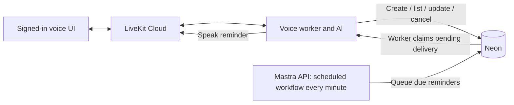

# Voice reminders implementation plan

Prepared October 4, 2026. Implemented locally on `codex/voice-reminders`; the sections below retain the implementation design and demo acceptance checks.

Build one-time reminders that Al saves in Neon and speaks during the user's active LiveKit call. Mastra runs a scheduled workflow every minute to find due reminders. The voice worker delivers them through the existing call and conversation UI.

## Decisions and scope

- Assume the user normally keeps the voice call connected.
- Support creating, listing, canceling, and rescheduling one-time reminders by voice.
- Use the existing account system, Neon database, Mastra, LiveKit, and orb UI.
- Run the Mastra API/scheduler, voice worker, and Next.js UI locally in three separate terminals for the demo.
- Aim for delivery within roughly 70 seconds of the due time when the services are healthy and the conversation is idle. Speaking or service downtime can delay it further. This is an acceptance target to measure, not an exact alarm guarantee.
- Keep recurrence, email/SMS, outbound calls, calendar appointments, and a reminders dashboard for later.

Example:

> User: Remind me on October 25 to go to the doctor.
>
> Al: What time should I remind you?
>
> User: Nine in the morning.
>
> Al: I'll remind you on October 25 at 9 AM, Pacific time.
>
> At the due time, during a quiet moment: Reminder: go to the doctor.

Confirm the timezone first if it is unknown. Al's confirmation follows a successful database write. Saving this reminder does not book a doctor's appointment.

## Existing pieces to reuse

Based on the existing account/memory implementation:

| Existing file | Relevant behavior |
| --- | --- |
| `src/mastra/storage.ts` | `PostgresStore` connects to Neon; its pool is already used for application tables. |
| `src/mastra/accounts.ts` | Authenticated account IDs, hashed sessions, versioned memory resources, and transactional table initialization. |
| `src/mastra/account-routes.ts` | Generates trusted call metadata after authentication; ignores client-supplied account/memory context. |
| `src/mastra/agents/al.ts` | Spoken agent, memory tools, and current instructions saying reminders are unavailable. |
| `src/mastra/voice-worker.ts` | LiveKit session, greeting, turn completion, memory buffering, and call-end finalization. |
| `src/mastra/index.ts` | Central registration for agents, tools, storage, and future workflows. |
| `ui/app/api/voice/route.ts` | Server-side voice connection gateway for the signed-in UI. |

The existing `startScheduleTool` runs the general-purpose agent on a recurring cron. Keep it separate: Al needs account-owned, one-time reminders and delivery into a live call.

Installed versions checked: `@mastra/core` 1.74.0, `@mastra/livekit` 0.4.2, `@mastra/pg` 1.29.0, and `@livekit/agents` 1.9.1. Date conversion uses `@js-temporal/polyfill` 0.5.1. Reload the Mastra skill and check the installed types/docs before future changes. Online docs can describe newer APIs.

## Architecture



The durable handoff is a small Postgres outbox: a table of pending deliveries. The API and LiveKit jobs run in different processes, so a server-side JavaScript map of sessions would not connect them. The worker polls the shared database and speaks only reminders belonging to its authenticated account. This design needs no Redis or new webhook service.

The scheduler performs database work. It does not call an LLM to decide whether something is due. The model interprets the user's request when saving it; delivery reads the saved reminder as plain text.

## 1. Persist reminders and delivery state

Add `src/mastra/reminders/store.ts` and extend the existing schema initialization in `accounts.ts`. Use the same Neon database, parameterized SQL, transactions, and migration locking convention. Keep application tables separate from Mastra's internal schedule tables. [Mastra Neon integration](https://mastra.ai/integrations/databases/neon)

Create these tables:

| Table | Fields and constraints |
| --- | --- |
| `al_reminders` | UUID `id`; account foreign key; bounded `message`; `due_at` as `timestamptz`; IANA `timezone`; original local date/time; `status` (`scheduled`, `queued`, `completed`, `canceled`); integer `version`; originating thread/tool-call IDs; timestamps. Unique creation key scoped to the account. Index scheduled rows by `due_at`; index account listings. |
| `al_reminder_deliveries` | UUID `id`; reminder/account IDs; reminder version; status (`ready`, `leased`, `speaking`, `spoken`, `interrupted`, `uncertain`, `failed`, `canceled`); attempt count; `next_attempt_at`; lease token/expiry; voice-session ID; start/completion timestamps; sanitized error code. Unique `(reminder_id, reminder_version)`. Index ready work by account and next attempt. |
| `al_voice_sessions` | UUID `id`; account ID; server-created thread/resource IDs; backend-only link to the authenticated session hash; room/participant identity; activation time; heartbeat and expiry; state (`pending`, `active`, `superseded`, `closed`). Enforce one active delivery session per account. |

Also persist an explicitly confirmed reminder timezone for the account. The memory profile's learned timezone can suggest a value, but should not silently set scheduling preferences.

Own reminders by the stable account UUID. The current `al:<accountId>:<memoryVersion>` resource changes when memory is forgotten; it is unsuitable as the reminder owner. Memory deletion should not silently cancel reminders. Explain this distinction in the forget behavior and support explicit reminder cancellation.

Use a server/runtime-provided originating tool-call ID for creation retries. Verify that ID is available in the installed tool context; otherwise supply a stable execution ID through the backend. An LLM-generated random key is insufficient. Replaying the same tool invocation returns the existing reminder; a deliberately repeated new request is a separate decision.

## 2. Resolve dates and add Al's tools

Add `src/mastra/reminders/time.ts` and `src/mastra/tools/reminder-tools.ts`.

| Tool | Input | Result |
| --- | --- | --- |
| `create_reminder` | Message, complete local date/time, IANA timezone | Saved reminder ID, normalized instant, and readable local confirmation |
| `list_reminders` | Optional status/date filters, bounded limit | This account's reminders and delivery outcomes |
| `cancel_reminder` | Reminder ID | Actual cancellation outcome, including already completed/in-progress cases |
| `update_reminder` | Reminder ID, replacement date/time/timezone and optional message | Updated reminder and confirmation |

Define Zod input/output schemas with `createTool`; use `execute(inputData, context)`. Read account ownership from trusted request context and verify it against the stored call/session. Do not accept an account ID in model-visible input. Every query/update includes account ownership. [Mastra tools](https://mastra.ai/docs/agents/tools)

In `account-routes.ts`, attach a server-created voice-session ID, stable account ID, and confirmed timezone to dispatch metadata/request context. Store the authorization association in Neon; do not send raw login tokens to LiveKit. Refresh the current clock for each turn/tool execution so a long call does not use its start time as "now."

Date rules:

- Ask one focused question for missing time, ambiguous dates, or an unknown timezone.
- Interpret relative dates using the user's confirmed timezone and the current server clock. Never substitute the computer's timezone for the user's confirmed timezone.
- Resolve the year explicitly. If using the next upcoming October 25, include the resolved date in the tool result and confirmation; clarify when the user could mean something else.
- Convert local time to a UTC instant in backend code; validate again independently of the model's suggested conversion.
- Reject past instants and invalid dates. For daylight-saving gaps or repeated local times, ask for clarification rather than silently shifting the time.
- Store the IANA zone separately: Postgres `timestamptz` preserves an instant, not the original named timezone. [Postgres date/time types](https://www.postgresql.org/docs/current/datatype-datetime.html)

Use a timezone-aware library with explicit ambiguity handling, such as Temporal with a polyfill if needed by the runtime. Verify runtime support before selecting the dependency. [Temporal ZonedDateTime](https://tc39.es/proposal-temporal/docs/zoneddatetime.html)

Attach the tools to Al, register them in `index.ts`, and replace Al's "cannot set reminders" instruction. Require successful tool results before claiming an action. Return clear errors for unsupported recurrence and ambiguous reminder selection. Studio calls without authenticated account context must fail safely rather than creating an unowned reminder.

## 3. Add the Mastra scheduled workflow

Create `src/mastra/workflows/dispatch-reminders.ts`, with one short database step and a result such as `{ queuedCount }`.

Planned workflow configuration:

```ts
// Configuration sketch; complete schemas/step implementation later.
createWorkflow({
  id: 'dispatch-reminders',
  // inputSchema, outputSchema ...
  schedule: {
    cron: '* * * * *',
    timezone: 'UTC',
    inputData: {},
  },
})
// .then(queueDueReminders).commit()
```

Register it under `workflows` in `src/mastra/index.ts`. Mastra supports declarative workflow schedules; keep the local Mastra process running for its scheduler to fire. [Scheduled workflows](https://mastra.ai/docs/workflows/scheduled-workflows)

Each run:

1. Select a bounded batch of `scheduled` reminders where `due_at <= now()`, ordered by due time.
2. Lock those rows, insert their delivery rows, and change reminder status to `queued` in the same transaction.
3. Use the unique reminder/version constraint to make repeat workflow executions harmless.
4. Process further bounded batches within a short run-time budget; leave remaining work for the next tick.

Use `FOR UPDATE SKIP LOCKED` for competing queue/claim operations. Keep transactions short; never hold a database transaction open during speech. [Postgres locking clauses](https://www.postgresql.org/docs/current/sql-select.html#SQL-FOR-UPDATE-SHARE)

After a restart, scanning overdue timestamps catches up on unsent reminders. This does not rely on Mastra replaying every missed cron tick. Updating a queued reminder increments its version, invalidates the old delivery, and returns it to `scheduled`; canceling invalidates unsent deliveries transactionally.

## 4. Route delivery into the active voice call

Add `src/mastra/reminders/voice-delivery.ts`; integrate it through `onSessionStart` in `voice-worker.ts`. The installed Mastra helper supplies `{ session, ctx, agent, metadata }`. Preserve existing greeting, turn-completion, and call-end memory hooks. [Mastra LiveKit hooks](https://mastra.ai/integrations/voice/livekit)

At connection time the backend creates a pending session row. At `onSessionStart`, verify that row, the account authorization, and the current memory resource; activate it atomically. Lock the account while replacing any previous active delivery session. For two browser tabs, the latest successfully activated call receives reminders. Older calls cannot overwrite its heartbeat or claim its deliveries.

Start an asynchronous, serialized loop and return promptly from `onSessionStart`. Suggested initial settings: poll every two seconds, heartbeat every five seconds, expire inactive sessions after 30 seconds. Stop the loop and release its session on close using `ctx.addShutdownCallback`; cleanup must be independent of memory-hook early returns. Sign-out/session expiry and memory-resource invalidation stop delivery authorization.

For each due delivery:

1. Wait for the user to stop speaking and the agent to be idle/listening. Recheck immediately before speaking; coordinate with normal turns so reminder audio is not layered over a reply.
2. Claim one delivery transactionally with a lease token, only if this is still the account's active, authorized session.
3. Revalidate reminder version/status and session ownership, then persist `speaking` before producing audio. Renew leases while speaking.
4. Speak the fixed string `Reminder: ${message}` with `session.say(text, { allowInterruptions: true, addToChatCtx: true })`.
5. Await the returned speech handle's `waitForPlayout()`. Inspect its interruption/error outcome before recording `spoken` and marking the reminder `completed` in one fenced transaction.

Use the installed JavaScript API, not the Python examples: [AgentSession.say](https://docs.livekit.io/reference/agents-js/classes/agents.voice.AgentSession.html#say), [SpeechHandle](https://docs.livekit.io/reference/agents-js/classes/agents.voice.SpeechHandle.html).

Cancellation can prevent audio before speech starts; it cannot retract words already played. If cancellation races with delivery, return an honest in-progress outcome and attempt to interrupt the tracked reminder speech.

Keep reminder text as speech data, never as new system instructions. Fixed-text speech avoids unnecessary model latency and prevents reminder contents from being interpreted as instructions to execute tools.

## 5. Define delivery outcomes and transcript behavior

Choose these explicit MVP behaviors:

| Situation | Behavior |
| --- | --- |
| No connected call | Keep the delivery ready. Deliver at a quiet moment after a later authenticated connection, identifying it as overdue. |
| Database/TTS failure before any speech starts | Retry with bounded backoff, initially 1, 5, then 30 seconds; record a visible failure after the retry budget. |
| User interrupts the reminder | Record `interrupted`; do not immediately repeat it over the conversation. Al can explain/read it when the user asks. |
| Crash/connection loss after speech starts, before completion is recorded | Mark the expired attempt `uncertain`; do not blindly replay possibly heard speech. |
| Expired claim that never entered `speaking` | Safely reclaim it after revalidating ownership/version. |
| Successful playback | Record `spoken`/`completed`; this means audio played, not that the human acknowledged it. |

These policies provide retryable database work and bounded audio duplication. Database transactions cannot guarantee exactly-once human hearing across a worker crash.

Verify that proactive speech appears in the existing UI chat. `addToChatCtx` should also let Al understand a follow-up such as "What was that reminder?" Test both behaviors. Preserve the committed reminder utterance in Mastra call memory once, using a delivery-derived message ID if the helper does not persist proactive speech automatically. Do not add a second persistence listener for all normal turns; the bridge already handles them.

Keep interruption outcomes truthful in memory; do not save unplayed words as a fully delivered reminder. Run the existing buffering/finalization path so call summaries include the delivered reminder. Log IDs, status, timing, attempts, and sanitized error codes; retain the existing trace filtering of conversation content.

## 6. Separate scheduler and voice runtime roles

The voice worker currently imports `mastra` from `index.ts`, and LiveKit also imports it in job processes. Explicitly disable scheduling in every voice process.

Use a project-specific environment variable set before Node loads modules:

```ts
// Planned Mastra constructor option in index.ts.
scheduler: { enabled: process.env.AL_PROCESS_ROLE !== 'voice' }
```

The installed core source explicitly treats `scheduler.enabled: false` as disabling scheduler injection. This keeps other worker/memory facilities available. Register the same tools/agents/workflow centrally in `index.ts` in both roles.

Prefix `voice:dev` with `AL_PROCESS_ROLE=voice`, preserving its existing env-file loading:

```json
"voice:dev": "AL_PROCESS_ROLE=voice node --env-file=.env --env-file-if-exists=.env.local --import tsx src/mastra/voice-worker.ts dev"
```

Keep `MASTRA_WORKERS` unset for this design. Setting it even to `false` changes scheduled workflow execution-engine selection and introduces a different worker topology. Run exactly one scheduler instance; verify that opening two calls still produces only one scheduler tick stream. [Mastra worker configuration](https://mastra.ai/reference/workers/overview)

## 7. Run the local demo

Use the existing `.env` setup from `README.md` for Neon, OpenAI, and LiveKit credentials. Download the voice models once if this computer has not already done so:

```sh
pnpm exec livekit-agents download-files
```

Run these in three terminals from the repository root and leave them running:

```sh
# Terminal 1: API, scheduler, and Studio
pnpm run dev
```

```sh
# Terminal 2: LiveKit voice worker
pnpm run voice:dev
```

```sh
# Terminal 3: signed-in orb UI
pnpm run ui:dev
```

Use the signed-in UI at `http://localhost:3000` for voice reminder tests. Inspect workflow runs and the recurring dispatcher schedule in Studio at `http://localhost:4111/workflows/schedules`. Studio exposes the dispatcher cadence, not a separate schedule per personal reminder; use `list_reminders` to inspect those.

For a quick demo, ask Al to remind you about something two minutes from now. Leave the call connected, wait for the reminder, and check the chat transcript. Restart the voice worker after changing agent or tool code.

## Implementation order and acceptance checks

1. **Database and time handling:** add tables, account timezone, repository operations, deterministic clock/conversion tests, ownership tests, and transactional queue/claim tests.
2. **Voice tools:** add/register tools; update Al's instructions; test actual voice clarification, save, list, reschedule, and cancel.
3. **Scheduled workflow:** register the minute dispatcher; prove restart catch-up and idempotent repeated runs; verify scheduler disabled in voice jobs.
4. **Live delivery:** integrate the session loop, speech outcomes, cleanup, and transcript/memory behavior; preserve existing memory tests.
5. **Local demo:** verify the `voice:dev` runtime-role setting, run all three terminals, and complete a two-minute reminder test through the signed-in UI.

Acceptance tests before calling the feature complete:

- "Remind me on October 25" asks for a time and unknown timezone; confirmation matches the stored instant. Include daylight-saving gap/repeated-hour cases.
- A reminder created for two minutes ahead is heard once during an idle call and appears in chat; follow-up recall works.
- A due reminder waits while the user is speaking; interruption does not mark it successfully completed.
- Cancel/reschedule before delivery prevents the old version from being spoken; tool retries do not create duplicate reminders.
- Account A cannot list, cancel, change, or receive account B's reminders, even with a known reminder ID.
- Two tabs route delivery to the newest active call; stale session cleanup cannot remove the new route.
- Restart the API before the due time and after it: the reminder survives and overdue work catches up. Re-running the workflow creates one delivery row.
- Crash the worker before speech and after speech starts: verify safe reclaim versus `uncertain` outcomes.
- Sign-out, session expiry, and memory-resource reset prevent delivery into an invalidated call. A new authenticated call can still access its account-owned reminders.
- Existing call summaries, profile extraction, forget operations, and normal voice turn-taking continue working.

Use `pnpm test` for the new meaningful backend/integration checks. Stop the dev server before `pnpm run build`. Run UI checks only if UI/gateway files change; use `pnpm run ui:build` for that build. Finally repeat the two-minute voice test locally and measure the delivery delay.

Regression checks: `pnpm test` covers date handling, database ownership/leases, and the voice controller. `AL_REMINDER_LLM_SMOKE=1 pnpm test` checks actual model tool use. With both local backend processes running, `AL_REMINDER_LIVEKIT_SMOKE=1 pnpm test` checks the real scheduled delivery, audio, chat transcription, and follow-up context using a headless caller.
